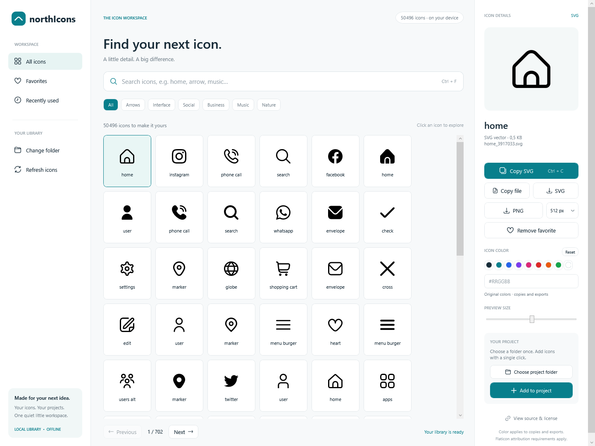
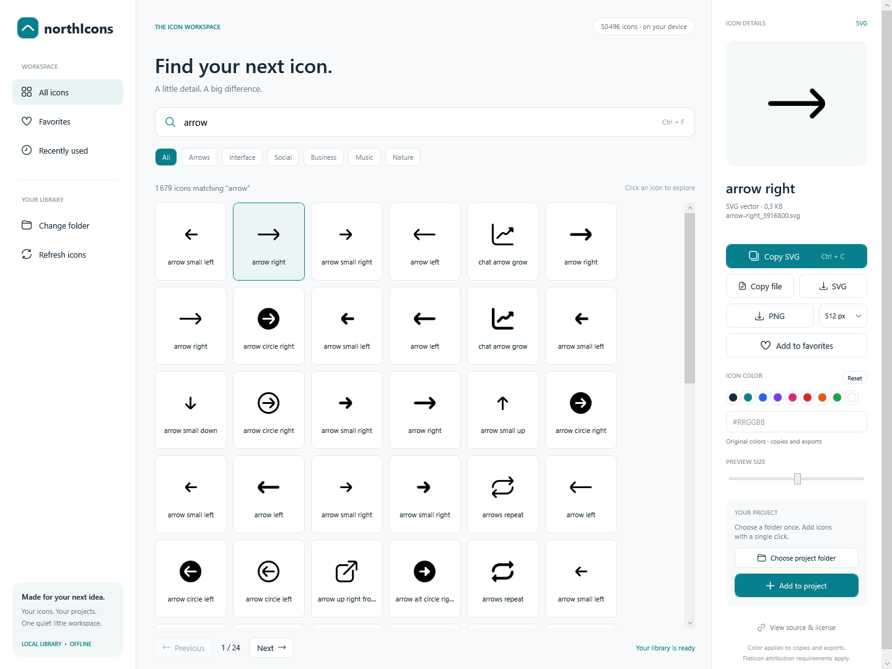
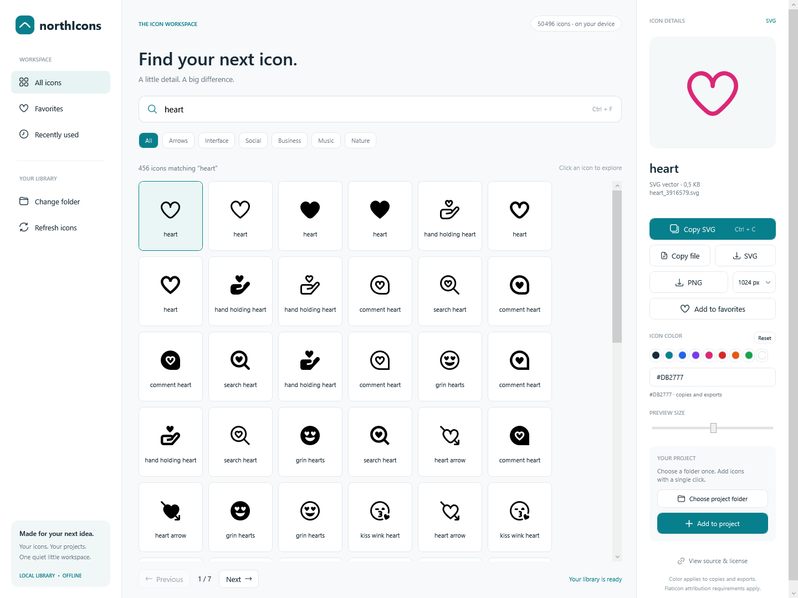

<div align="center">

# northIcons

**Find your next icon. Make it yours.**

A Windows desktop workspace for searching, previewing, coloring, and exporting SVG icons, with a compressed icon library included in the source tree.

**WPF · .NET 10 · Local library · Offline workflow**

</div>



## Features

- **Search your collection** by filename, with quick category filters and paged results.
- **Preview SVGs** at different sizes before using them.
- **Make icons your own** with preset colors or a custom hex value.
- **Copy SVG markup or files** straight into your workflow.
- **Export SVG and transparent PNG**, with PNG sizes from 64 to 2048 px.
- **Add to your project** with a saved destination folder.
- **Keep favorites and recent icons** close at hand.
- **Work offline** with your local SVG files.

## Screenshots

### Find the right icon

Search across your library and compare variations in a clean grid.



### Choose a color. Export in seconds.

Apply a preset or enter a hex color, then copy the SVG or export a transparent PNG.



*Screenshots show the included local collection. You can also choose another SVG folder.*

## Get started

### Run from source

You need Windows and the **.NET 10 SDK or a newer compatible SDK**.

From the project folder:

```powershell
dotnet run --project northIcons.csproj
```

### Run a compiled copy

Open `northIcons.exe`. Framework-dependent builds require the **.NET 10 Desktop Runtime**.

### Included icon library

The source tree includes `Icons.zip`, containing **50,496 SVG files** and their source references. On first launch, northIcons unpacks it into a local cache automatically. Later launches reuse that cache; users do not need to unzip files manually.

Both build and publish commands copy `Icons.zip` into their output folders. Keep it beside `northIcons.exe` when sharing a compiled build. Use **Change folder** to select another SVG library. Replacing the ZIP with an updated library automatically creates a new cache on the next launch.

```text
northIcons/
├── Icons.zip               # Compressed SVG library and sources.tsv
├── Assets/                 # Embedded UI icons and source references
├── docs/screenshots/       # README images
├── MainWindow.xaml         # WPF interface
└── northIcons.csproj        # Application and packaging configuration
```

Commit `Icons.zip` to source control. The supplied `.gitignore` excludes unpacked `Icons/` folders, generated binaries and build output while retaining the ZIP and screenshots. The extracted library is stored under `%LOCALAPPDATA%\northIcons\Library\`.

The ZIP is approximately **30.4 MiB**. Push it with Git or GitHub Desktop; GitHub's browser uploader has a [25 MiB per-file limit](https://docs.github.com/en/repositories/working-with-files/managing-files/adding-a-file-to-a-repository).

## Your everyday workflow

1. Search for an icon or choose a category.
2. Select an icon to open its preview and actions.
3. Choose a color swatch or enter `#RGB` / `#RRGGBB`. **Reset** restores its original colors.
4. Use **Copy SVG**, **Copy file**, or the SVG/PNG export buttons.
5. Choose a project folder and use **Add to project** to save icons directly into it.

The selected color applies to the large preview, copied files and markup, project copies, and exports. Your original library files stay unchanged. Grid thumbnails retain their original colors.

PNG exports have transparent backgrounds and preserve the icon's proportions. Available sizes are **64, 128, 256, 512, 1024, and 2048 px**.

## Keyboard shortcuts

| Shortcut | Action |
| --- | --- |
| `Ctrl + F` | Focus search |
| `Ctrl + C` | Copy the selected SVG when a text field is not focused |
| `Esc` | Clear the focused search field |

## Build

```powershell
dotnet build northIcons.csproj -c Release
```

Create a self-contained Windows x64 build:

```powershell
dotnet publish northIcons.csproj -c Release -r win-x64 --self-contained true -o publish
```

The self-contained build includes the .NET runtime. Keep the published files together when distributing the app.

## SVG support

The built-in preview renderer supports paths, basic shapes, groups, transforms, and simple class styles. Advanced features such as masks, gradients, and embedded images are not supported for preview or PNG export. SVG files can still be copied or exported when a preview is unavailable.

Search and category filters use icon filenames. Favorites, recent icons, and folder preferences are saved locally in:

```text
%LOCALAPPDATA%\northIcons\settings.json
```

## Icon attribution

Icons retain their respective authors' licenses and attribution requirements. Use **View source & license** to visit an icon's source page when source information is available. Source references for the app's embedded UI icons are included in [Assets/sources.tsv](Assets/sources.tsv).

The third-party collection is separate from the application code. Flaticon's [standard terms, section 8.3](https://www.flaticon.com/legal), restrict redistribution in icon collections. Publishing these library files requires separate redistribution permission; attribution alone does not grant it. Per-file source references are included as `sources.tsv` inside [Icons.zip](Icons.zip).


